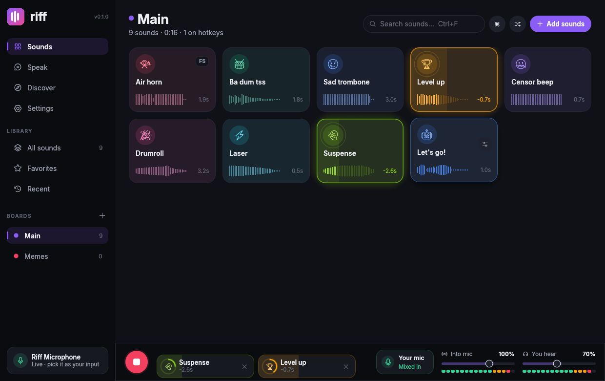

<p align="center">
  
</p>

<h1 align="center">Riff</h1>

<p align="center">
  A fast, good-looking soundboard for Linux, written in Rust.<br>
  It plays your sounds and text-to-speech into a <b>virtual microphone</b>, with global hotkeys and Freesound search.<br>
  It replaces <a href="https://github.com/sardeq/BoomBx">BoomBx</a>.
</p>

<p align="center"></p>

## Features

**Your sounds go straight into voice chat**
- Riff creates its own **Riff Microphone** on PipeWire or PulseAudio. You don't need VB-Cable or any drivers. Pick it as your input in Discord, a game or OBS. Riff removes it again when you quit.
- **Mic passthrough** mixes your real microphone into Riff Microphone, so a single input carries both your voice and your sounds. There's also optional **ducking**, which lowers your voice while a sound plays.
- **Two buses** with live meters: what goes into the mic, and what you hear. Each sound can go to the mic, to your speakers, or to both.
- A **soft limiter** stops stacked sounds from clipping. **Auto-level** evens out loudness between clips.

**Pads that feel good to use**
- Pads come in a grid with waveforms, colors, emoji icons and hotkey badges. A playing pad glows and fills up as it plays.
- **Per-sound effects:** volume, speed and pitch (with Chipmunk and Demon presets), bass boost, echo, fade in and out, looping, and trimming with draggable handles on the waveform.
- **Boards:** drag pads onto a board to move them, or onto another pad to reorder. Favorites and Recent are built in.
- Riff can **restart, stop or layer** a pad that's already playing, and has a "one sound at a time" mode.
- **Drag and drop** files or whole folders. It reads mp3, wav, ogg, flac, m4a and aac, and anything else ffmpeg can decode if it's installed.
- **Ctrl+K command palette:** fuzzy-find any sound, board or action.

**Hotkeys that work on Wayland**
- **Global hotkeys** read your keyboards through evdev, so they work on niri, Hyprland, Sway, KDE, GNOME and X11. Numpad and F13–F24 work too.
- **CLI and compositor binds:** you can control Riff with `riff play "Air horn"`, and Riff can copy a ready-made niri or Hyprland bind line for any pad.

**Text to speech that stays on your computer**
- **Piper** gives natural neural voices. Riff includes a voice browser for the whole Piper catalog, including Arabic (`ar_JO-kareem`). Voices download in one click.
- **espeak-ng** is instant and tiny, and has fun voice characters like whisper, croak and retro.
- You can speak a line into the mic, preview it only for yourself, or **save it as a pad**.

**Discover**
- You can search **Freesound.org** from inside Riff and filter by length and popularity. **Previews play only for you**, and one click adds a sound with its license info.

## Quick start (NixOS)

```bash
nix develop            # rustc, cargo, pkg-config, libpulse, espeak-ng, piper-tts, pactl
cargo run --release
```

Then open your voice app's audio settings and choose **Riff Microphone** as the input.

To install it like any other program:

```bash
git add -A             # flakes only see files that git tracks
nix build              # → ./result/bin/riff  (wrapped with all runtime deps)
nix run                # or run it directly
```

Or add it to your system flake:

```nix
inputs.riff.url = "github:sardeq/riff";
# …
environment.systemPackages = [ inputs.riff.packages.x86_64-linux.default ];
```

### Global hotkeys permission

Riff reads `/dev/input/event*`. On NixOS:

```nix
users.users.<you>.extraGroups = [ "input" ];
```

Log out and back in afterwards. If you'd rather not do that, use compositor binds instead (below).

## Command line

```
riff                      open Riff (or bring the running window to front)
riff play <sound>         play a sound by name (fuzzy) or id
riff toggle <sound>       play, or stop if it's already playing
riff stop [<sound>]       stop one sound, or everything
riff random [<board>]     play a random sound
riff pause                pause / resume everything
riff mic [on|off|toggle]  mix your real mic into Riff Microphone
riff say <text>           speak text into the mic with your TTS voice
riff list                 list boards and sounds
```

niri (`~/.config/niri/config.kdl`):

```kdl
binds {
    Mod+Shift+1 { spawn "riff" "play" "Air horn"; }
    Mod+Shift+0 { spawn "riff" "random"; }
    Mod+Escape  { spawn "riff" "stop"; }
}
```

Hyprland:

```
bind = SUPER SHIFT, 1, exec, riff play "Air horn"
```

## Keyboard shortcuts (inside the window)

| Key | Action |
| --- | --- |
| `Ctrl+K` | Command palette |
| `Ctrl+F` | Search the board |
| `Ctrl+O` | Import files |
| `Esc` | Stop everything |
| `Ctrl+Click` a pad | Edit it |
| `Ctrl+Enter` (Speak) | Say the text |

## Freesound

1. Make a free account at [freesound.org](https://freesound.org).
2. Apply for an API key at <https://freesound.org/apiv2/apply/>.
3. Paste the key in **Discover** (or in **Settings → Freesound**).

Each sound is added with its author and license (CC0 / CC BY / CC BY-NC). Credit the author when the license asks for it.

## Where things live

| What | Path |
| --- | --- |
| Library and settings | `~/.config/riff/` |
| Imported sounds, TTS clips, Piper voices | `~/.local/share/riff/` |
| Freesound previews (cache) | `~/.cache/riff/` |
| Control socket | `$XDG_RUNTIME_DIR/riff.sock` |

## How it works

```
 pads / hotkeys / CLI ──► mixer (48 kHz, per-voice FX)
                           ├─ mic bus ──► riff_sink (null sink) ─► .monitor ─► riff_mic  "Riff Microphone"
                           │    ▲
                           │    └── your real mic (passthrough, optional ducking)
                           └─ monitor bus ──► your speakers / headphones
```

- `src/audio/` contains the mixer, decoding (symphonia), the PulseAudio/PipeWire backend, virtual device routing (`pactl`) and the built-in starter sounds. The starter sounds are generated by code, not recorded.
- `src/hotkeys.rs` has the hotkey model, the evdev global listener and the niri/Hyprland bind generator.
- `src/tts.rs` drives Piper and espeak-ng, and handles the Piper voice catalog and downloads.
- `src/freesound.rs` is the Freesound APIv2 client.
- `src/ui/` holds the egui interface: the theme, pads, inspector, deck, Speak, Discover, Settings and the palette.

## Roadmap

- Windows: a cpal backend already exists, and VB-Cable routing and global hotkeys still need to be ported
- A tray icon, so Riff keeps running after you close the window
- XDG GlobalShortcuts portal support, for KDE and GNOME without the `input` group
- Recording clips from your mic or desktop audio
- Import and export of boards

## License

GPL-3.0-or-later (see [LICENSE](LICENSE)). Fonts: Inter and Noto Emoji (SIL Open Font License 1.1). Icons: Phosphor (MIT).
